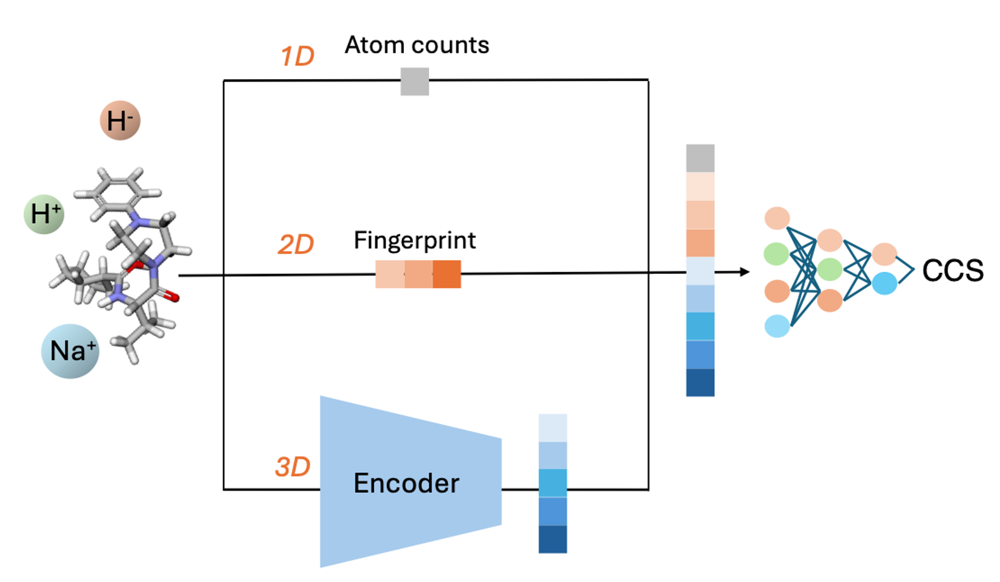

# UEFCCS
UEFCCS was developed for collision cross section (CCS) prediction

written in python 3.10, pytorch 2.9, cuda 12.8

## Setting up Conda environment

Create new Conda environment using environment.yml.  

    conda env create -f environment.yml
    conda activate uefccs

## Git clone repository

    git clone https://github.com/ypsh1/UEFCCS.git
    cd uefccs
    
## Running evaluation
Once uefccs is correctly installed, please check the location of uefccs

    pip show uefccs

copy the fine-tuned weights form https://drive.google.com/file/d/1ja3TR2ltQBPxf87CPUa1-vAyNesIpIvg/view?usp=drive_link to the subdir "uefccs/lib/python3.10/site-packages/unimol_tools/weights/"
    
    python UEFCCS_predict.py --input_csv /test.csv --output_csv /predicts.csv
    
## Reproduce  

please  refer UEFCCS architecture
1. finetune

   python ./data_prepare/finetune.py

2. generating the [CLS] token

    pythoon ./data_prepare/get_cls_token.py

3. training

   python UEFCCS_train.py

## Citation

If you use this code, please cite:

    @article{ypsh1_2026UEFCCS,
          title={}, 
          author={},
          journal={},
          year={2026}
    }

## License
MIT
