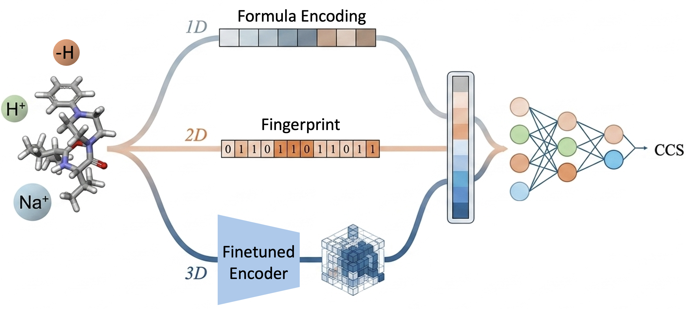

# 🔍 UEFCCS
UEFCCS was developed for collision cross section (CCS) prediction

## 📦 Setting up Conda environment

UEFCCS was written in python (3.10) and used pytorch (2.9.1) with CUDA (12.8). 

Create new Conda environment using environment.yml.  

    conda env create -f environment.yml
    conda activate uefccs

## 📁 Git clone repository

    git clone https://github.com/ypsh1/UEFCCS.git
    cd uefccs
    
## 🎯 Prediction
Once uefccs is correctly installed, please check the location of uefccs

    pip show unimol_tools

copy the fine-tuned weights form https://drive.google.com/file/d/1ja3TR2ltQBPxf87CPUa1-vAyNesIpIvg/view?usp=drive_link to the subdir "uefccs/lib/python3.10/site-packages/unimol_tools/weights/"
    
    python UEFCCS_predict.py --input_csv test.csv --output_csv predicts.csv
    
## ⚡Reproduction 

1. finetune

#Fine-tune the UniMol model to obtain updated weights (ckpt)

   python ./data_prepare/finetune.py   

2. generating the [CLS] token

#Please load the updated weights (ckpt) to the UniMol before running this command
#The updated weights (checkpoint) refer to the .pth file with the best MSE achieved during 5-fold cross-validation

    python ./data_prepare/get_cls_token.py  

3. training

   Alternatively, directly download the obtained cls_token saved as a .pt file, and the above two steps can be skipped. https://drive.google.com/file/d/1MvmNKxmCnGSBV69csZx7MPxf1hVN2od2/view?usp=sharing
 
   python UEFCCS_train.py  --csv_path /your_csv  --cls_tensor /your_path_to_cls_token
   

## 📖 Citation

If you use this code, please cite:

    @article{ypsh1_2026UEFCCS,
          title={}, 
          author={},
          journal={},
          year={2026}
    }

## License
MIT
